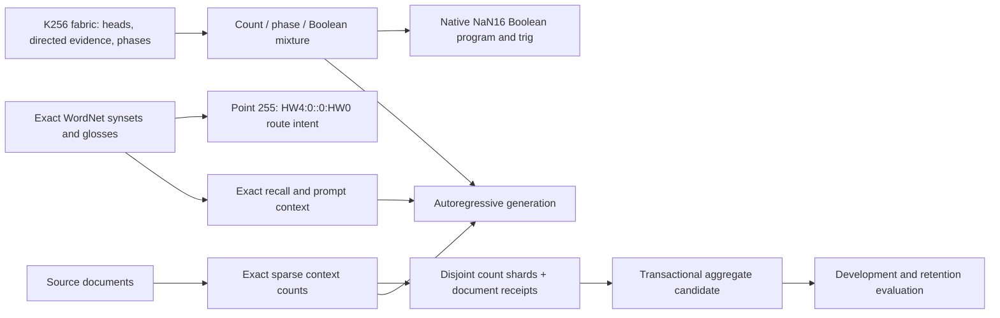

# Sequence learning and independent-universe aggregation

The latest upstream update is integrated through `00c2eba`. It corrects the
initial negative result by isolating the shared rotor, requiring 100% transfer
on the synthetic offset task, verifying inverse linkage after restart, and
adding a conventional closed-form offset control. Both controls score 3.390766
nats on unseen contexts. This is stronger than Harmony's deliberately softer
3.97032 distribution. Harmony does **not** beat that matched-prior baseline.
Its purpose is conditional use of competing models, compact trig, native rule
translation, and an explicit path from sequences to a persistent fabric.



The two generative paths are currently separate experts. The diagram does not
imply that the sparse context learner has been calibrated into Harmony's mixture.

## Working sequence learner

`tools/context_lm.py` is a standard-library-only, variable-context autoregressive
byte model. It trains every suffix up to a configured order (default eight),
using exact sparse integer counts in SQLite. Witten–Bell interpolation backs
off from long contexts; the unigram has half-count smoothing over 255 bytes.
Prediction is normalized; sampling traverses the interpolation mixture
without dense vocabulary softmax. Byte 255 resets context and is never emitted.
Raw generation can contain non-UTF8 bytes; redirect it to a file when needed.

A context is an exact byte string, not a hash into 256 semantic buckets. Its
last-byte/next-byte relation still has the fabric's existing head addresses;
its longer exact identity lives in the sparse overlay, analogous to WordNet's
exact synset overlay. The SQLite overlay is currently a separate host-side
sequence expert: it is not yet jointly trained with Harmony or projected into
root pair counts. Naming it `ROOT.context.sqlite` expresses ownership; it does
not claim mmap/network integration that is absent from the implementation.

Training is one streaming pass, O(order * bytes) work. The pending counter
flushes at 65,536 distinct edges; inference caches at most 4,096 context rows.
Transactions include both counts and a SHA-256 document receipt, so a failed
training operation rolls back and an identical file is not counted twice.
Input is hashed again during ingestion to detect concurrent file changes.
Counts are signed SQLite integers with overflow rejected by a CHECK constraint.
The training transaction can produce a large WAL; disk space must cover it.
Exact counts grow with corpus diversity: bounded host buffers do not mean
bounded total model size, and no universal compression ratio is promised.

A 1 MiB repetitive diagnostic took 2.37 seconds (~442 KB/s), ~35 MiB peak
process RSS, and 36 KiB of final SQLite storage for 613 distinct edges here.
This is a repetition/compression smoke test, not evidence of billion-token
throughput. Diverse natural corpora can create millions of rows and much
larger disk files. The document receipt sets in aggregation reside in RAM.

## Train and generate

```
make nanlm
./nanlm /tmp/universe-a init
python3 tools/context_lm.py /tmp/universe-a.context.sqlite train corpus-a.txt
python3 tools/context_lm.py /tmp/universe-a.context.sqlite eval development.txt
python3 tools/context_lm.py /tmp/universe-a.context.sqlite generate \
  --prompt 'the little ' --bytes 512 --seed 11 > sample.bin
```

Run an order-zero model as a matched unigram baseline. Keep development data
separate from final evaluation documents, and split by source/document before
training. Repeated substring contamination is not detected by file hashes.
The test suite's held-out sentence recombination scores 0.657336 nats/byte,
versus 2.759343 for unigram. It is a tiny controlled grammar, not an open-domain
language benchmark. A sample begins `fox walks through the quiet forest.`
The model is a functioning language sampler with limited context and no
reasoning guarantee. Fluency and factual breadth still require suitable data.

## Exact knowledge and the mandatory gateway

```
./nanlm /tmp/universe-a import-wordnet /path/to/data.noun
./nanlm /tmp/universe-a wordnet-link dog
python3 tools/context_lm.py /tmp/universe-a.context.sqlite recall \
  /tmp/universe-a.wordnet.tsv dog
python3 tools/context_lm.py /tmp/universe-a.context.sqlite generate \
  --wordnet /tmp/universe-a.wordnet.tsv --lemma dog --prompt 'A dog ' \
  --bytes 256 > grounded-attempt.bin
```

Recall returns exact glosses with synset identity, leaf, gateway=255, and
`HW4:0::0:HW0` link. Retrieval context can prefix generation; its provenance is
printed to stderr. With eight-byte history, most long retrieved context will
fall outside the model window. This mechanism is not a factuality guarantee:
use the exact recall result for facts. Missing lemmas return no facts. Leaf
collisions do not conflate synsets. Actual HW4 network transport is still absent.

## Independent training and additive aggregation

```
python3 tools/context_lm.py /tmp/worker-a.sqlite train corpus-a.txt
python3 tools/context_lm.py /tmp/worker-b.sqlite train corpus-b.txt
python3 tools/context_lm.py /tmp/candidate.sqlite merge \
  /tmp/worker-a.sqlite /tmp/worker-b.sqlite
python3 tools/context_lm.py /tmp/candidate.sqlite eval development.txt
```

The worker databases are local artifacts that can be copied between machines;
there is no service discovery, scheduler, networking, or automatic deployment.
Transfer a closed/checkpointed database or SQLite backup, not an arbitrary
live `.sqlite` file with its WAL omitted. Each imported source is read under a
stable transaction. Each destination import commits atomically. Whole-document
receipts make duplicate imports idempotent. Disjoint imports are associative
and commutative, and tests show exact equality with sequential training.

Partially overlapping aggregates are rejected: aggregated counts do not retain
per-document contributions, so subtracting an intersection would be unsound.
Send disjoint leaf shards or a completely new aggregate instead. Hashes identify
content, not who produced it; worker authentication, signed manifests, partial
overlap splitting, trust weighting, poisoning resistance, and transport replay
protection remain future protocol work. Contributors must be trusted today.

Do not average phase angles, Boolean instruction words, NaN tags, quaternion
components, or independently normalized expert weights. These are not additive
sufficient statistics. Phase moments can eventually merge as sum_cos/sum_sin;
quaternion means require gauge alignment; global expert posteriors should be
recalibrated on common development data. This implementation merges only exact
sequence count statistics and receipts. It does not merge mmap roots or WordNet
graphs, and it does not claim that adding statistics creates a unified mind.

## Next integration gates

1. Measure document-disjoint prose and WordNet gloss performance against
   context-only, Harmony-only, and a calibrated combined expert.
2. Add an explicit versioned root/overlay ownership manifest and native NaN16
   inference bridge; retain full exact context identity in every route payload.
3. Connect real NaNNet transport at point 255, with authenticated shard manifests
   and checked source IDs. Validate wire syntax instead of treating a label as ABI.
4. Benchmark diverse multi-GB ingestion, journal compaction, crash recovery,
   corpus overlap management, and long-running workers before scaling out.
5. Promote candidates only after retention, contradiction, calibration, and
   held-out checks. Keep generation separate from factual evidence acquisition.
